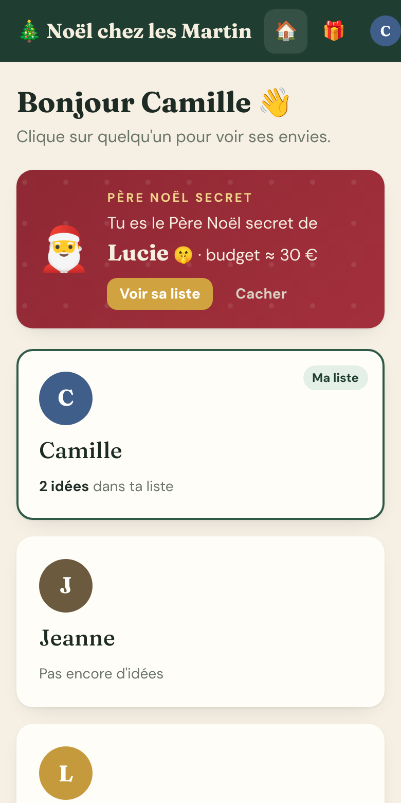
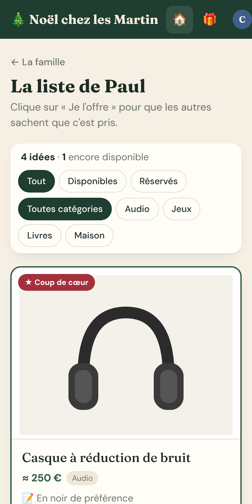
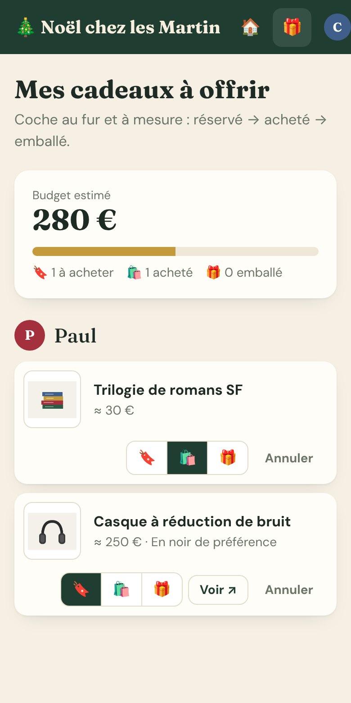
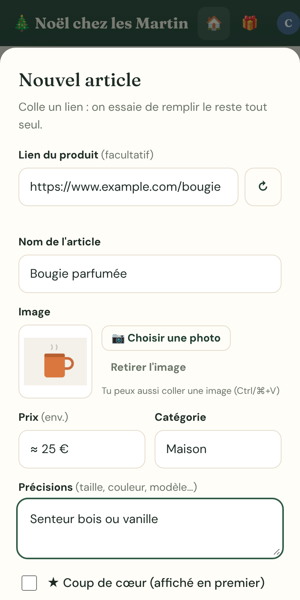

<p align="center">
  
</p>

<h1 align="center">HoHoHost</h1>

<p align="center"><strong>Les listes de cadeaux de la famille, auto-hébergées. Fini les doublons.</strong><br>
Chacun ajoute ses envies, la famille réserve ce qu'elle offre, et le destinataire ne voit jamais ce qui a été réservé.</p>

<p align="center"><a href="README.md">🇬🇧 English version</a></p>

<p align="center">
  
  
  
  
</p>

## Fonctionnalités

- **Une liste par personne** : on colle le lien d'un produit et HoHoHost remplit le nom, la photo et le prix (liens Amazon courts et affiliés compris), ou on ajoute une photo depuis son téléphone.
- **Réserver un cadeau** : un clic sur « Je l'offre » et toute la famille voit que c'est pris. **Le destinataire ne voit jamais les réservations faites sur sa liste.**
- **Mes cadeaux à offrir** : ta liste de courses pour toute la famille, avec le budget estimé et le suivi réservé → acheté → emballé.
- **Père Noël secret** : tirage au sort avec exclusions (couples) et budget conseillé. Personne, même pas l'admin, ne voit le tirage complet.
- **Questions anonymes** sur un article (« quelle taille ? »). Le destinataire répond, tout le monde voit la réponse.
- **Discussion « Entre nous »** sur chaque liste, invisible pour son destinataire.
- **Listes des enfants** : les parents créent et co-gèrent la liste d'un enfant (ou d'un proche sans compte) et voient ce qui est réservé.
- **Ajout depuis le téléphone** : installable sur l'écran d'accueil (PWA), présent dans le menu Partager sur Android, raccourci en 2 actions sur iPhone.
- **Pastilles « nouveautés »**, et bouton « Nouvelle saison » pour archiver les cadeaux offerts après Noël.
- **Connexion simple et privée** : prénom + nom + code à 6 chiffres, uniquement pour les membres ajoutés par l'admin. Blocage après 5 erreurs. Pas d'email, pas de pisteur, polices servies en local.
- **Léger** : Node.js 22, SQLite, **zéro dépendance npm**. Sauvegarde automatique chaque jour (14 jours gardés).

## Installation rapide

### Docker Compose

```yaml
services:
  hoho-host:
    image: ghcr.io/aphl1/hoho-host:latest
    container_name: hoho-host
    restart: unless-stopped
    ports:
      - "3000:3000"
    environment:
      - TZ=Europe/Paris
      - PUID=1000
      - PGID=1000
    volumes:
      - ./data:/data
```

Ouvre ensuite `http://<ton-serveur>:3000`. L'**assistant de démarrage** te demande le nom du site et crée ton compte admin. Ajoute ensuite les membres de ta famille dans **Admin**.

### Unraid

Cherche **HoHoHost** dans Community Applications (une fois validé). En attendant : **Docker → Add Container → Template URL** :

```
https://raw.githubusercontent.com/APHL1/hoho-host/main/templates/hoho-host.xml
```

> **Astuce Unraid :** garde le **port conteneur à 3000** (ne change que le port hôte si 3000 est pris) et fais pointer `/data` vers un **dossier dédié** comme `/mnt/user/appdata/hoho-host`, jamais vers `appdata` lui-même.

### CasaOS / ZimaOS

**App Store → Installation personnalisée → Importer** le fichier [`casaos/docker-compose.yml`](casaos/docker-compose.yml).

## Réglages

| Variable | Par défaut | Rôle |
|---|---|---|
| `PORT` | `3000` | Port dans le conteneur |
| `TZ` | `Europe/Paris` | Fuseau horaire |
| `PUID` / `PGID` | `1000` / `1000` | Propriétaire de `/data` (Unraid : `99` / `100`) |
| `SETUP_CODE` | *(vide)* | Facultatif. Si renseigné, l'assistant de démarrage demande ce code. Utile si l'app est accessible depuis Internet avant que tu l'aies configurée. |

**Volume :** `/data` contient `hoho-host.db`, `images/` et `backups/`. À sauvegarder !

## Rendre le site accessible à la famille

- **Tunnel Cloudflare** : aucun port à ouvrir, HTTPS gratuit. Cloudflare Access en option pour une connexion supplémentaire.
- Un **reverse proxy** (Nginx Proxy Manager, Caddy, Traefik) avec HTTPS.

Le site demande aux moteurs de recherche de ne pas l'indexer, et seuls les membres ajoutés par l'admin peuvent se connecter.

## Sauvegardes et restauration

Une copie de la base est faite chaque jour dans `/data/backups/backup-AAAA-MM-JJ.db` (14 dernières gardées). Pour restaurer : arrêter le conteneur, remplacer `/data/hoho-host.db` par une sauvegarde, supprimer `hoho-host.db-wal` et `hoho-host.db-shm`, redémarrer.

## Licence

[AGPL-3.0-or-later](LICENSE) : tu peux utiliser, modifier et héberger HoHoHost librement. Si tu distribues une version modifiée ou la proposes en service à d'autres, tu dois publier ton code sous la même licence.
