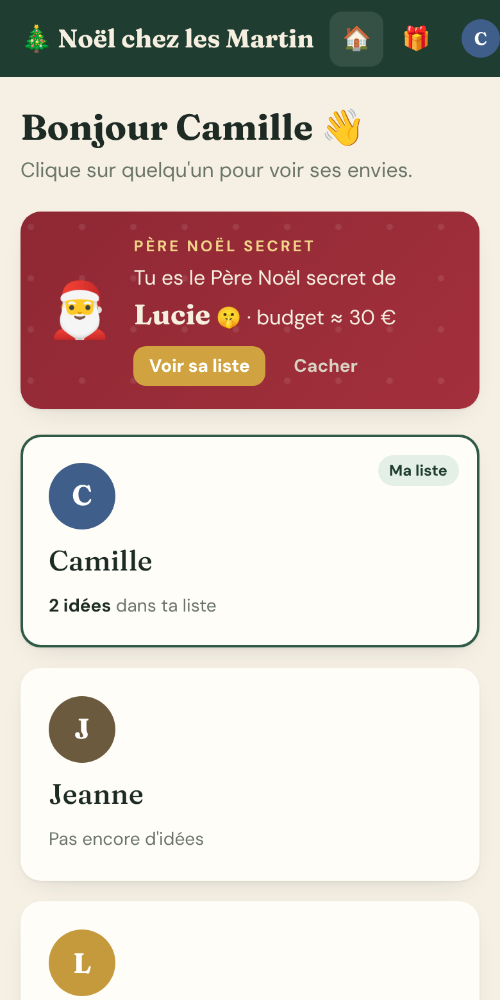
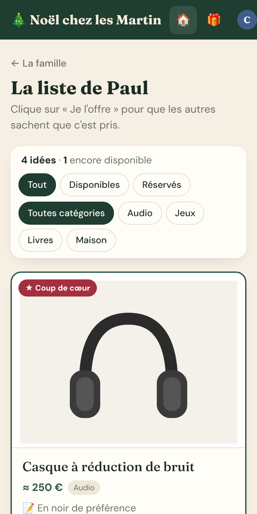
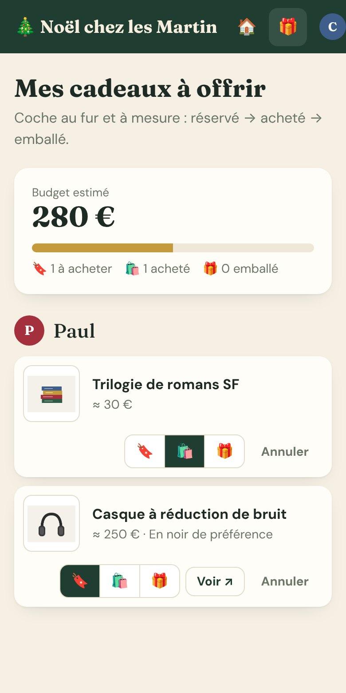
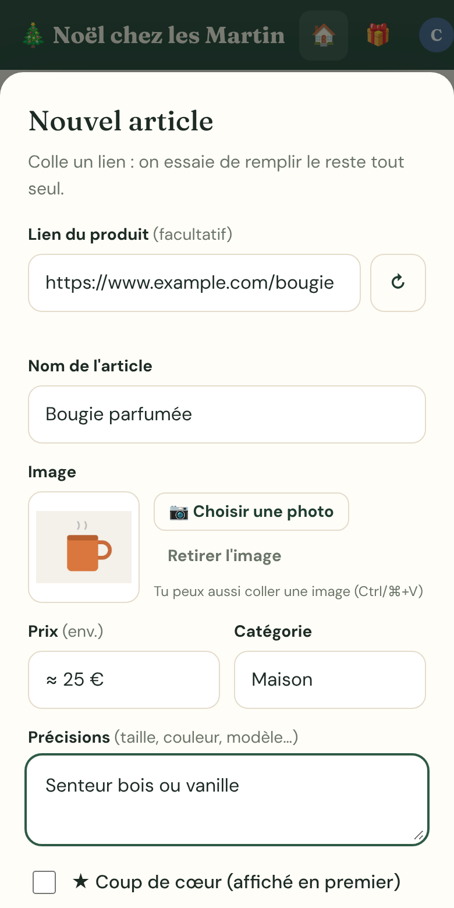

<p align="center">
  
</p>

<h1 align="center">HoHo-Host</h1>

<p align="center"><strong>Self-hosted family wishlists. No more duplicate gifts.</strong><br>
Everyone adds their wishes, the family reserves what they'll offer, and the recipient never sees what was reserved.</p>

<p align="center">
  <a href="LICENSE"></a>
  
  
</p>

<p align="center"><a href="README.fr.md">🇫🇷 Version française</a></p>

<p align="center">
  
  
  
  
</p>

> **Language:** the interface is in **French** for now. English is planned. Contributions welcome!

## Features

- **One wishlist per person**: paste a product link and HoHoHost fills in the name, picture and price for you (Amazon short and affiliate links supported), or add a photo from your phone.
- **Reserve a gift**: one tap on "Je l'offre" and the rest of the family sees it's taken. **The recipient never sees reservations on their own list.**
- **My gifts to offer**: your shopping list across the family, with an estimated budget and reserved → bought → wrapped tracking.
- **Secret Santa**: draw names with exclusions (couples) and a suggested budget. Nobody, not even the admin, can see the full draw.
- **Anonymous questions** on any item ("what size?"). The recipient answers, everyone sees the answer.
- **Hidden family chat** on each list, invisible to its owner. Perfect for "let's split this one".
- **Kids' lists**: parents create and co-manage lists for children (or anyone without an account) and see what's reserved.
- **Add from your phone**: install it on the home screen (PWA). On Android it shows up in the Share menu. On iPhone, a 2-step Shortcut does the job.
- **"New" badges** when someone adds ideas, plus a "new season" button to archive offered gifts after Christmas.
- **Simple and private sign-in**: first name + last name + 6-digit code, only for family members added by the admin. Lockout after 5 wrong codes. No email, no tracking, fonts served locally.
- **Lightweight**: Node.js 22, SQLite, **zero npm dependencies**, ~100 KB of code. Automatic daily backups (14 days kept).

## Quick start

### Docker Compose

```yaml
services:
  hoho-host:
    image: ghcr.io/aphl1/hoho-host:latest
    container_name: hoho-host
    restart: unless-stopped
    ports:
      - "3000:3000"
    environment:
      - TZ=Europe/Paris
      - PUID=1000
      - PGID=1000
    volumes:
      - ./data:/data
```

```bash
docker compose up -d
```

Open `http://<your-server>:3000`. The **setup wizard** asks for the site name and creates your admin account. Then add your family members in **Admin**.

### Docker run

```bash
docker run -d --name hoho-host -p 3000:3000 \
  -e TZ=Europe/Paris -v /path/to/data:/data \
  --restart unless-stopped ghcr.io/aphl1/hoho-host:latest
```

### Unraid

Search **HoHoHost** in Community Applications (once approved). Until then: **Docker → Add Container → Template URL**:

```
https://raw.githubusercontent.com/APHL1/hoho-host/main/templates/hoho-host.xml
```

> **Unraid tip:** keep the **container port at 3000** (change only the host port if 3000 is taken) and map `/data` to a **dedicated folder** such as `/mnt/user/appdata/hoho-host`, never to `appdata` itself.

### CasaOS / ZimaOS

**App Store → Custom install → Import** the file [`casaos/docker-compose.yml`](casaos/docker-compose.yml).

## Configuration

| Variable | Default | Description |
|---|---|---|
| `PORT` | `3000` | Port inside the container |
| `TZ` | `Europe/Paris` | Time zone |
| `PUID` / `PGID` | `1000` / `1000` | Owner of `/data` (Unraid: `99` / `100`) |
| `SETUP_CODE` | *(empty)* | Optional. If set, the first-run wizard asks for this code. Useful if the app is reachable from the internet before you finish setup. |
| `DATA_DIR` | `/data` | Where the database, pictures and backups live |

**Volume:** `/data` contains `hoho-host.db`, `images/` and `backups/`. Back it up!

## Exposing it to your family

HoHoHost is meant to be reached from outside your home (family members are not on your Wi-Fi). The usual options:

- **Cloudflare Tunnel**: no open port, free HTTPS. Optionally add Cloudflare Access for an extra login.
- A **reverse proxy** (Nginx Proxy Manager, Caddy, Traefik) with HTTPS.

The site sends `noindex` headers and `robots.txt` blocks crawlers. Only members added by the admin can sign in.

## Backups

A copy of the database is written every day to `/data/backups/backup-YYYY-MM-DD.db` (last 14 kept). To restore: stop the container, replace `/data/hoho-host.db` with a backup, delete `hoho-host.db-wal` and `hoho-host.db-shm`, start again.

## FAQ

**I forgot my code.** Ask the admin: Admin → Reset code. You'll choose a new one at your next sign-in.

**Amazon doesn't fill in the details.** Amazon often blocks automatic page reading. HoHoHost still extracts the picture from the product ID, and keeps your link (affiliate tag included). Type the name by hand if needed.

**Can I use it for birthdays?** Yes. Change the site name in Admin → Settings, and use "New season" to archive offered gifts.

## Development

```bash
node server.js            # http://localhost:3000, data in ./data
```

No build step, no dependencies. Requires Node.js ≥ 22.5 (built-in `node:sqlite`).

## License

[AGPL-3.0-or-later](LICENSE). You can use, modify and self-host HoHoHost freely. If you distribute a modified version or run it as a service for others, you must share your source code under the same license.

Fonts: Fraunces and DM Sans, SIL Open Font License (see `public/fonts`).
